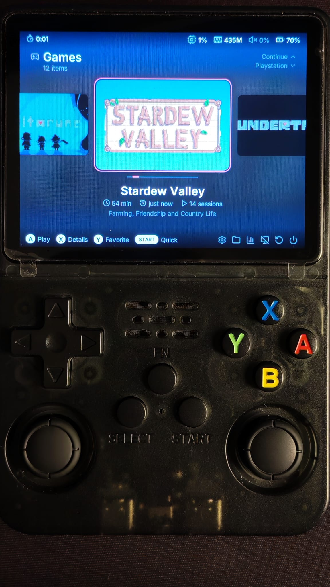
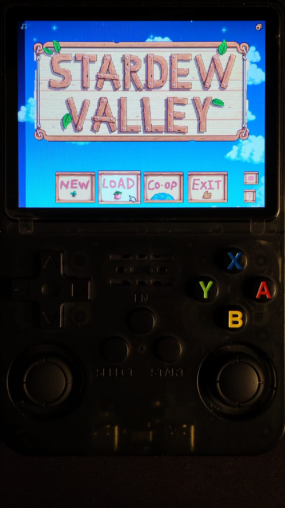
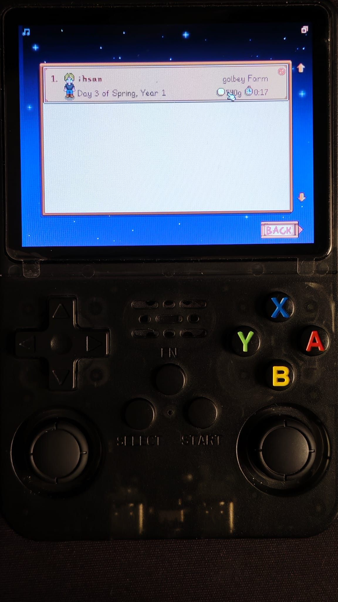
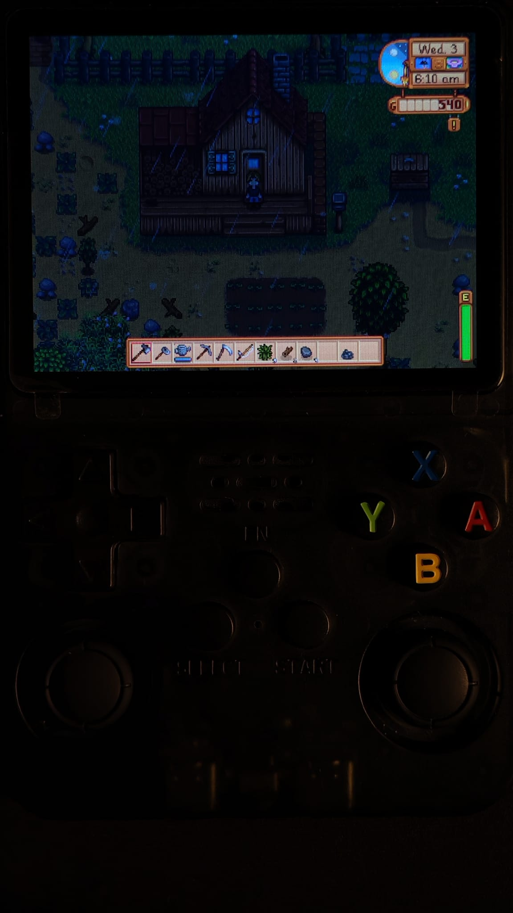
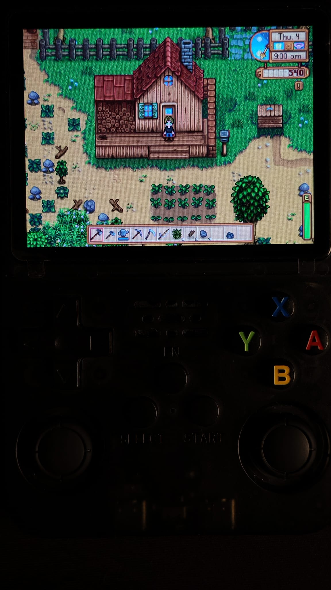
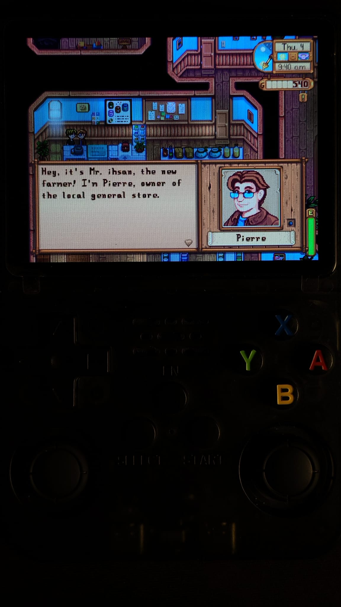

# Stardew Valley on GA36 — goodluckOS

  
  

  <strong>An ARMHF Stardew Valley port package for GA36-family handhelds running goodluckOS.</strong>

This repository documents and packages a Stardew Valley setup that the maintainer has running on a GA36-MB v1.2 handheld with goodluckOS 0.1.0. **This is not a claim that the maintainer independently created the original port.** The project focuses on preservation, attribution, packaging, and a clean user-provided-game installation.

> [!IMPORTANT]
> The latest tested, installable package will be published on the [Releases page](https://github.com/igol23/glOSports-stardew-valley/releases/latest). Until a release is published, do not treat the source tree as an installable HOME archive.

## Current status

- **Maintainer device:** GA36-MB v1.2 (A23-family board).
- **Firmware:** goodluckOS 0.1.0.
- **Runtime status:** the maintainer reports that the existing installed game runs on this device.
- **Public release:** not published yet.
- **Additional device testing:** not documented; compatibility with every GA36 variant is not implied.

Performance figures are intentionally omitted until they are measured on the exact published build and recorded with reproducible conditions.

## Screenshots

A quick look at the port running on the GA36 handheld — from the goodluckOS Games menu to everyday Stardew Valley gameplay.

<table>
  <tr>
    <td width="50%" align="center">
      
       <strong>1 · goodluckOS Menu</strong>
       Stardew Valley listed in the handheld's Games menu.
    </td>
    <td width="50%" align="center">
      
       <strong>2 · Title Screen</strong>
       The game's main menu.
    </td>
  </tr>
  <tr>
    <td width="50%" align="center">
      
       <strong>3 · Save Selection</strong>
       Save / Load screen for choosing a save.
    </td>
    <td width="50%" align="center">
      
       <strong>4 · Rainy Day</strong>
       In-game scene during rainy weather.
    </td>
  </tr>
  <tr>
    <td width="50%" align="center">
      
       <strong>5 · Sunny Day</strong>
       In-game scene in clear weather.
    </td>
    <td width="50%" align="center">
      
       <strong>6 · NPC Dialogue</strong>
       A conversation with a villager.
    </td>
  </tr>
</table>

## What it uses

The GoodLuckOS implementation combines a 32-bit ARMHF Mono runtime, PortMaster's MonoGame-based Stardew support, GL4ES for OpenGL ES, OpenAL Soft for audio, an LZ4 compatibility shim, and loader/patch tools. The launcher also synchronizes the game's language with the goodluckOS Puppy language setting.

## Requirements

- A GA36-family handheld running a compatible goodluckOS release.
- The tested baseline is goodluckOS 0.1.0 on GA36-MB v1.2.
- Your own legally obtained Stardew Valley game files.
- The Steam **Compatibility** build of Stardew Valley **1.6.15.24356** (32-bit/XNA). This port targets that Compatibility build, not an arbitrary/default game installation.

The game itself is not distributed here. This repository and its releases must not contain the Stardew Valley executable, proprietary game libraries, the game's Content directory, XNB/XWB assets, sound banks, save files, or other proprietary game data.

## Installation

A public installable release is not available yet. Once one is published:

1. Download the newest HOME-layout ZIP from [Releases](https://github.com/igol23/glOSports-stardew-valley/releases/latest).
2. Extract it into the root of the SD card's **HOME** partition, merging the supplied folders.
3. Copy your own game files from the Steam **Compatibility** build (**1.6.15.24356**, 32-bit/XNA) into `HOME/ports/stardewvalley/gamedata/`. The `StardewValley.exe` file and `Content/` directory should be inside that directory. Files from a different game build may not work.
4. Safely eject the card and return it to the handheld.
5. Launch **Stardew Valley** from Puppy's Games section.

The release archive will contain only an instruction placeholder in `gamedata/`, not the game. Do not upload your personal game files, saves, settings, or local environment overrides.

See [INSTALL-TR.md](INSTALL-TR.md) for the Turkish installation guide.

## Building and releasing

- [BUILDING.md](BUILDING.md) explains the pinned source import and build workflow.
- [RELEASING.md](RELEASING.md) explains the packaging, audit, and publication checklist.
- [PROJECT-PLAN.md](PROJECT-PLAN.md) tracks the project stages and release blockers.
- [UPSTREAMS.md](UPSTREAMS.md) records upstream origins and pinned revisions.
- [THIRD_PARTY_NOTICES.md](THIRD_PARTY_NOTICES.md) summarizes third-party notices.

The existing working installation is preserved as the reference. A clean rebuild is useful for contributors, but it is not a prerequisite for claiming that the maintainer's existing installed port works.

## Credits and upstream work

- **CodeZombie / goodluckOS:** early feasibility research and technical discussion about ARMHF Mono and Stardew Valley on GA36-family hardware. See [goodluckOS issue #73](https://github.com/CodeZombie/goodluckOS/issues/73).
- **alvesmaicon:** the documented practical GoodLuckOS Stardew port implementation, build workflow, patches, and performance work. See the [Stardew Valley port documentation](https://github.com/alvesmaicon/goodluckOS/blob/develop/docs/ports/README.md#stardew-valley) and the pinned [build script](https://github.com/alvesmaicon/goodluckOS/blob/b7a3ca2d1de2077557760e05655cb555ea35b98d/dev/stardew/build.sh).
- **JohnnyonFlame / PortMaster contributors:** MonoGame streamed-audio work, loader and patch components used by the upstream GoodLuckOS build. Original notices and source attribution must be preserved.
- **The maintainer:** device testing, packaging, documentation, and local integration work. The exact local changes will be described only after comparison against the pinned upstream sources.

Stardew Valley is created by ConcernedApe. This is an unofficial community project and is not affiliated with or endorsed by ConcernedApe.

## License

The GoodLuckOS-derived project source follows the upstream repository's GNU GPL version 2 license; see [LICENSE](LICENSE). Third-party components retain their own licenses and notices. See [LICENSES/README.md](LICENSES/README.md) and [THIRD_PARTY_NOTICES.md](THIRD_PARTY_NOTICES.md).

Stardew Valley and its proprietary game files remain the property of their respective rights holders and are not included in this repository's public releases.
